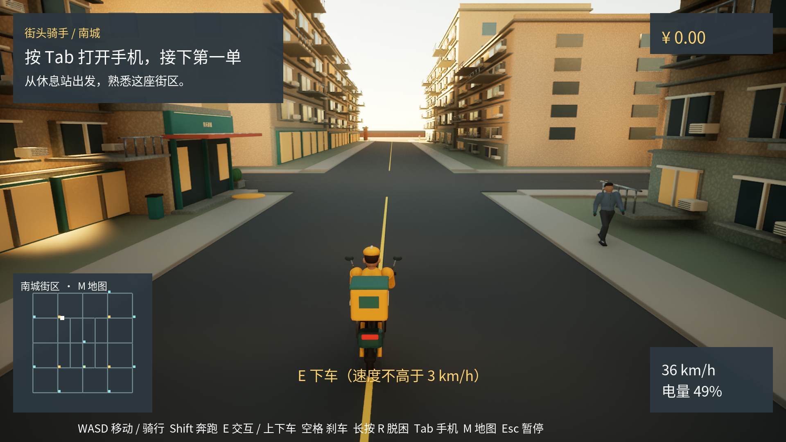

# 街头骑手 / 南城

Windows 单人 3D 外卖配送游戏，基于 Unreal Engine 5.6.1。首版街区约 600×600 米，包含 4 家商户、8 个收餐点、两条近路和骑手驿站。



## 启动

正式版本入口：`Artifacts/Windows/Shipping/CityCourier.exe`。保留整个 Shipping 文件夹及其中的 `CityCourier`、`Engine` 目录，不能单独复制根目录的小型启动 exe。

本机也可双击 `D:\eleme\街头骑手.lnk`。工程与完整包保存在 `D:\eleme\.worktrees\city-courier`；移动工程后需重新创建该快捷方式。Shipping 完整目录约672 MiB，附带 `开始游戏.txt` 和字体许可。

开发版本位于 `Artifacts/Windows/Development/CityCourier.exe`。打开工程使用 `CityCourier.uproject`，本机引擎位于 `D:\sdk\UE_5.6`。

## 第一单

1. 按 **Tab** 打开手机，查看候选订单的取餐、送餐和总路程；可先预览路线，再接单。
2. 靠近电动车按 **E** 上车，沿小地图导航前往商户；按 **M** 查看完整街区和路线。
3. 按空格刹停，以不超过 3 km/h 的速度按 **E** 下车。步行到商户入口 2 米以内，再按 **E** 取餐。
4. 导航会切换到收餐点。到达后下车、步行靠近入口并按 **E** 交付，查看结算。
5. 回到骑手驿站可免费充电和购买升级。

## 操作

| 按键 | 功能 |
| --- | --- |
| W A S D | 步行 / 驾驶；停车后 S 倒车 |
| 鼠标移动 | 转动镜头 |
| Z（按住） | 趴下，配合 WASD 匍匐移动；松开且空间足够时起身 |
| 左 / 右 Shift | 步行奔跑 |
| Ctrl（按住） | 蹲下，配合 WASD 蹲行 |
| E | 交互、上下车、取餐、交付 |
| 空格 | 步行跳跃 / 电动车刹车 |
| 鼠标左键 / 右键 | 轻拳 / 重拳；对应动画未交付时提示未就绪，不产生不可见命中 |
| Tab | 手机、接单、取消订单和没电救援 |
| M | 完整地图 |
| Esc | 暂停菜单 / 返回游戏 |
| 长按 R 两秒 | 脱困；有订单时增加 5 秒配送用时 |

同时只配送一单。基础车速 36 km/h、续航 3 公里；车辆升级分别改善动力、转向和电池。电量按实际移动距离消耗，撞击会损伤餐品。超时后有 60 秒宽限期，期间送达按 60% 比例结算；失败不扣除已有余额。手机和地图不会暂停配送计时，Esc 暂停菜单会暂停世界。

手机提供“去驿站”“找车”和“恢复订单导航”；绕路不会取消订单或暂停计时。找车读取车辆实际位置，上车后结束找车。接单距离按刷新时位置估算，刷新会替换空闲候选；预览不接单、不改变当前导航。

驿站服务要求下车、进入入口 2 米内，车辆在驿站 12 米内、无人骑乘且停稳。充电需完整等待 5 秒，提前离开或关闭服务会取消。操作失败会显示具体原因。远离驿站且电量为零时，手机可确认救援；会终止当前订单，回到驿站并充满电。

“订单历史”保留最近 20 单，点击查看商家、收货点、用时、完整度、失败原因和收入明细。列表和明细可滚动，查看时订单继续计时。

## 设置与进度

Esc 菜单提供总音量和低 / 中 / 高画质。中档使用软件 Lumen，1080p 输出采用 83% 内部分辨率重建；高档使用 100% 内部分辨率，硬件光追默认关闭。

常规打包版进度位于 `%LOCALAPPDATA%\CityCourier\Saved\SaveGames`；指定 `-UserDir` 的验证进程使用各自独立目录。主文件 `CourierProfile.sav`，最近一次有效备份为 `CourierProfile.bak`。余额、升级、设置和历史自动保存，活动订单不跨游戏重启保留，也不会凭空生成失败记录。

版本 1 存档自动迁移至版本 2，保留原有资料，历史从本版本开始记录；旧程序不能读取新版存档。未知更高版本不会自动覆盖或降级，需使用兼容程序，或由玩家明确确认重置。

保存失败时，界面会提示“本次进度未保存”；恢复磁盘空间或写入权限后点“重试保存”。存档损坏会先尝试有效备份，原损坏文件会保留。如果主文件和备份均不可恢复，界面提供两次确认的“创建新进度”，会将余额和升级归零。需要手动备份时先关闭游戏，再复制整个 SaveGames 文件夹。

退出游戏需要确认；存在未保存进度时会再次尝试保存并提示问题。

## 工程与验证

```powershell
./scripts/Build.ps1 -Target Editor -EngineRoot D:/sdk/UE_5.6
./scripts/Test.ps1 -Filter CityCourier -EngineRoot D:/sdk/UE_5.6
./scripts/Package.ps1 -Configuration Shipping -EngineRoot D:/sdk/UE_5.6
```

设计和实施记录在 `docs/superpowers`；美术源文件和音源在 `AssetsSource/CityCourier`，制作流程见 [美术制作说明](docs/art/authoring.md)，来源见 [素材清单](docs/art/asset-manifest.csv)。中文字体保留 Noto CJK 的 OFL 许可证。

本次更新见 [功能完善版验证](docs/testing/function-improvements-validation.md)；首版历史证据见 [验收记录](docs/testing/acceptance.md)、[发行检查](docs/testing/release-checklist.md) 和 [性能报告](docs/testing/performance.md)。运行时不需要 Python、Blender 或 UE 编辑器。

正式角色使用新版慢跑／快跑、左右轻拳、右手重拳及跳跃动作。WASD 慢跑、Shift 快跑、左键轻拳（连击窗口内再按一次接右拳，跳跃中可出拳）、右键重拳；骑乘和界面中不触发出拳。按住 Z 趴下并用 WASD 匍匐移动，按住 Ctrl 蹲下并蹲行。来源与重建见 [正式动作接入记录](docs/art/production-actions.md) 和 [蹲姿与匍匐动作](docs/art/posture-actions.md)。

## 首版范围

当前使用原创简化模型和固定傍晚街区；自由步行、骑行和配送循环已实现，画面规模与精细度不等同于 GTA 成品。背景交通为最多 6 辆车、12 名行人的有限巡行和避障。首版不包含多人、建筑内部探索、警察、战斗、真实地图平台、真实支付、天气或昼夜循环。

## Integrated art preview

main includes gameplay and updated art. The game starts in L_CourierCity; the editor opens L_CourierArtPreview. See [art preview guide](docs/art/preview-guide.md) for sources and rebuilding. Existing packages in the original worktree predate this merge. Build and package main to use the merged version.

第三轮增加有实际内部空间的面馆、便利店和烧腊店，细化衣服褶皱、衣领袖口与鞋袜贴合，并接入 Poly Haven 的完整 CC0 树木、做旧空调及周转箱模型。模型保留原始 UV 和独立法线、粗糙度、透明裁切贴图；资源下载记录包含 SHA-256 校验。新增 [店面近景](docs/art/previews/shop.png)，完整对比见 [打磨记录](docs/art/polish-notes.md)。这些店面内部仅作视觉展示，原建筑碰撞保留。

外部美术素材使用免费 CC0 资源，中文字体为 SIL OFL。来源见 [素材清单](docs/art/asset-manifest.csv)，原文件及授权记录在 `AssetsSource/CityCourier/External`；建筑、电动车和其余道具由项目制作。新增 [Mesh2Motion 动作及 CharMorph 写实度试验](docs/art/character-probe/README.md) 保留为独立测试关卡，尚未替换正式角色和动画。当前仍未达到照片级；人物表情、动态布料、建筑重复度和街区生活密度仍需打磨。各轮图片和性能数据适用的版本边界见 [验收记录](docs/testing/acceptance.md)。
