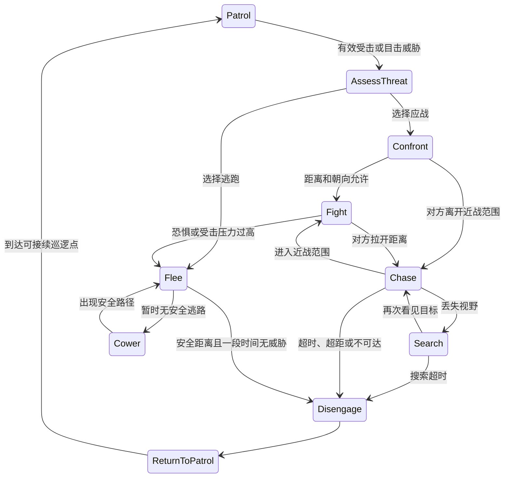

# 行人受击、反击、追击与脱战行为设计

状态：用户于 2026-10-21 确认设计并选择本会话执行；源码与动画已实施。随后按用户明确要求完成编辑器编译、导航生成、Shipping 打包并启动游戏；行为实玩与自动化验证尚未执行。用户要求参考 GTA 公开资料，尽可能完善现有行人行为。遵守 AGENTS.md：后续修改不自动编译、打包、运行游戏，需用户明确要求。

## 目标与参考边界

让街头行人受到攻击后，按照个体性格和当前处境作出应战、逃跑、求援或脱战反应；应战者能够接近攻击者、面向目标、出拳，被打断或击倒后正确恢复。行为应当可读、可配置、可调试，并适应本项目目前的性能预算。

借鉴事件响应、任务分层、战斗属性和近战控制的结构，自行实现 UE 代码；不导入 GTA 资源，也不把社区逆向资料说成 Rockstar 官方源码。以下所有距离、时间、概率都是本项目的初始设计值，不是 GTA 原版参数。

参考资料：

- [FiveM 战斗属性](https://github.com/citizenfx/natives/blob/master/PED/SetPedCombatAttributes.md)：是否应战、是否逃跑、是否追赶、是否允许徒手对抗持械目标是不同属性。
- [SA 受伤事件响应](https://github.com/gta-reversed/gta-reversed/blob/master/source/game_sa/Events/EventHandler.cpp)：`ComputePersonalityResponseToDamage` 分派攻击、逃跑等响应。
- [SA 徒步近战任务](https://github.com/gta-reversed/gta-reversed/blob/master/source/game_sa/Tasks/TaskTypes/TaskComplexKillPedOnFootMelee.cpp)：接近、格斗、等待、转身示威和任务终止。
- [SA 格斗控制](https://github.com/gta-reversed/gta-reversed/blob/master/source/game_sa/Tasks/TaskTypes/TaskSimpleFightingControl.cpp)：朝向、距离和动作时机影响攻击。
- [SA 逃离目标任务](https://github.com/gta-reversed/gta-reversed/blob/master/source/game_sa/Tasks/TaskTypes/TaskComplexSmartFleeEntity.cpp)：维护威胁位置，按周期更新逃跑目标。

这些资料不足以确定 GTA V 普通行人的统一放弃追击距离；本项目将明确实现自己的退出规则。

## 当前实现与约束

- `AAmbientPedestrian` 继承手动移动的 `AAmbientVehicle`，不是 `APawn`；当前 12 个行人由 `AAmbientTrafficManager` 复用。
- 现有身体反应为 Walking、Staggering、Falling、Down、GettingUp。单次轻拳硬直，1.2 秒内两次轻拳或一次重拳击倒；倒地保持 2 秒后尝试起身。
- `ICourierStrikeReceiver` 只有拳击 ID、位置、动作，不能可靠识别攻击者。
- 目前没有配置行人 NavMesh；巡逻是两个位置之间的直线往返。配送道路图不能直接当作包含可通行人行道和障碍信息的行人导航图。
- 行人使用独立 CharMorph 骨架，只有五段动画。骑手已有受击反馈入口，但没有人物生命、死亡、医疗系统。

## 方案选择

| 方案 | 优点 | 代价 |
| --- | --- | --- |
| 只增加追赶和反击分支 | 改动少 | 直线追击、身体状态和行为互相覆盖，后续难以扩展 |
| 独立决策状态 + 有限导航 + 现有行人池（采用） | 保留已有资产、碰撞和对象池，状态可独立检查 | 需要补齐事件上下文、导航和动画 |
| 改为 Character/AIController/行为树 | 方便使用完整 UE AI 工具 | 要迁移整个行人基类、碰撞、生成和已有动画验证；本次成本过高 |

## 架构与职责

1. **事件上下文**：在现有接收接口上增加携带攻击者弱引用的入口，保留原有位置型入口的适配。真实命中从 `CourierActionComponent::TraceSlice` 传递上下文。旧入口仍可触发身体反应，但不得猜测第一个玩家就是攻击者。
2. **决策状态**：新增 `CitizenBehavior` 单元，管理性格、威胁、应战/逃跑选择、计时和退出原因；决策规则与 UE 查询分离，便于检查。
3. **身体反应**：继续由 `AmbientPedestrian` 管理硬直、倒地、起身与碰撞。身体反应不再默认清除敌意；恢复时重新评估行为。
4. **战斗移动**：新增 `CitizenNavigation` 单元，处理可达路径、最后可见位置、局部避障、地面支持和卡住判断。
5. **动画与命中**：`CitizenAnimInstance` 处理行人专用动作；反击通过实际拳头轨迹产生接触，调用现有受击接口。
6. **群体协调**：交通管理器分配固定性格种子、限制围攻数量、分发有限目击事件，统一清理回收状态。

所有目标使用弱引用。状态中不持有让已销毁角色存活的强引用。复用时清除目标、路径、计时、攻击实例和最近命中记录。

## 身体状态和行为状态

身体状态保留现有五种；行为状态独立为：Patrol、AssessThreat、Confront、Chase、Search、Fight、Flee、Cower、Disengage、ReturnToPatrol。

硬直、倒地、起身期间暂停主动移动和出拳，但保留威胁记忆。新受击能够打断攻击前摇或追击；倒地/起身仍不能被重复命中重置计时。起身后可能继续应战，也可能因累计压力改为逃跑。

## 性格、激怒与威胁

- 初始提供谨慎、普通、好斗三种配置，生成权重为 30% / 50% / 20%。不依据外观、性别或种族推断性格。
- 谨慎型受击后优先逃跑；普通型倾向反击徒手攻击者，连续受挫后撤离；好斗型追击更积极、承受压力更高，仍受路径和追击上限约束。
- 为每个配置暴露勇气、攻击倾向、追击许可、最大追击时间、压力退出阈值。随机响应只在威胁开始时抽取并保存，不每帧重新抽取。
- 有效轻拳增加 20 压力，重拳/击倒增加 45，安全脱离后每秒恢复 5；普通型达到 70、好斗型达到 100 时选择撤离。此压力值不替代原有击倒判定。
- 攻击者是当前威胁来源；目击事件不能覆盖直接攻击者。只对真实接触成功、且攻击者仍有效的命中建立敌意；重复拳击 ID 不增加压力或刷新追击时间。
- 普通碰撞不直接引发战斗；短时间重复推挤只转身警告。持械恐惧等分支由未来实际武器事件驱动，不根据任意动画猜测。

## 接近、追击与搜索

| 参数 | 普通型初始值 |
| --- | --- |
| 警告/评估时长 | 0.35–0.75 秒，受击恢复后开始 |
| 接近/追击速度 | 240 / 380 cm/s；仍可被骑手冲刺甩开 |
| 攻击开始距离 | 根节点水平距离不超过 135 cm，另检查高度与实际拳轨迹 |
| 退出近战距离 | 180 cm，避免在边界频繁切换 |
| 攻击朝向 | 目标位于正前方 ±35°；转身有角速度上限 |
| 视野记忆 / 原地搜索上限 | 3 / 5 秒 |
| 最大追击时间 | 20 秒；好斗型 30 秒 |
| 事件地点活动半径 | 35 米；好斗型 50 米 |
| 无位移进展超时 | 2.5 秒；最多两次重规划后退出 |
| 再次被真实击中 | 更新威胁，但事件总追击预算不无限续期 |

追击只能使用当下可见目标位置；丢失视野后移动至最后可见位置，搜索结束前若重新看见目标才恢复追击。目标已销毁、离开有效世界、超出活动半径或路径持续失败时脱战。上车、骑车或进入建筑会重新评估可达性，不徒手追着高速车辆无限跑。

采用街道范围的静态 NavMesh，新增必要的 NavigationSystem 依赖和地图生成配置，复用现有 AActor 的手动移动；不迁移到 Character。直线可达时直接接近，绕障时使用导航路径。缺少导航数据时仅允许经过完整碰撞/地面检查的短距离移动；失败进入搜索/退出，禁止直接穿墙靠近。

本次追击范围是街道和可导航的室外区域。行人不打开玩家建筑门，不把配送室内路线作为穿门路径；玩家进入不可达室内时在最后可见位置搜索后脱战。移动每段都做扫掠、地面与台阶检查，不踩车顶追人、不跨越无支持区域、不通过传送修正卡住。

## 近战、动画与玩家反馈

- 补齐行人专用 `A_CitizenGuard`、`A_CitizenPunchL`、`A_CitizenPunchR`、`A_CitizenRun`、`A_CitizenCower`，沿用已保留的 CC0 动画来源重定向至独立行人骨架。源动作名称先核实，缺失时在独立 Blender 源文件中制作并记录来源。
- 保留五段现有身体反应，不改骑手参考骨架和既有动画。新增资源需保留 Blender、FBX、生成/导入脚本及来源清单。
- 每次出拳包含前摇、命中窗、收招和冷却；左右拳可交替。初始总长 0.7–0.85 秒、命中窗约 0.22–0.38 秒、攻击间隔 1.0–1.5 秒，最终以实际动画对齐。
- 攻击开始后锁定这次出拳的朝向，不瞬时旋转追踪已闪开的玩家。范围检查只决定能否出拳，不能替代碰撞命中。
- 命中窗采样实际手部骨骼轨迹，球形扫掠，检查阻挡、身高和可见性；一次攻击实例至多命中同一角色一次。墙、关闭的门、车辆遮挡会挡拳；攻击落空仍有收招。
- 动画未加载、骨架不兼容或动作被中断时不产生不可见伤害。无攻击资产的行人退回警戒/逃离，记录资源未就绪原因。
- 玩家被击中调用现有受击动作/打断入口，明确显示“遭到反击”。本次不额外加入死亡、扣钱、订单损毁或新存档字段；当前项目没有这些人物受伤规则。
- 玩家跳跃、蹲下或趴下时按实际接触判断，不能通过一个根节点距离直接判中。骑乘中不接受徒手凭空隔车命中。暂停遵循世界暂停；手机等界面沿用现有输入抑制和受击接收规则。

## 逃跑、求援与有限群体反应

- 从多个背离威胁的候选方向选择可达、安全且增大距离的逃跑点，不只沿玩家到行人的反方向直跑。
- 安全距离初始 20 米，连续 4 秒无可见威胁后进入脱战；逃路被堵则改选方向，暂时无路时畏缩防护并按周期重试。
- 受击事件可通知 12 米内最多 4 个有视线的活跃目击者。谨慎者避让/逃离；愿意援助者把原攻击者作为威胁；已经有直接威胁的行人不被覆盖。
- 同一目标最多两名主动近战参与者；只有一人获得当前出拳机会，其余在安全间距警戒，避免堆叠和同时无限硬直。令牌在收招、受击、脱战、回收、销毁时归还，并有失效兜底。
- 目击事件带源事件 ID、跳数和短期去重：目击者的逃跑不继续产生同类战斗事件，不形成全城递归仇恨。求援先表现为转头、姿态和有限同伴响应；不虚构尚不存在的警察/通缉系统。

## 脱战、返回与对象池

停止追击时记录具体原因，清除攻击窗口和围攻令牌，再进入短暂警戒冷却。返回原巡逻线上的最近可达接续点，随后正常巡逻；不能直接从当前位置穿建筑走向旧终点，也不在镜头中传送回出生位置。

回收必须取消行为、路径、目标、冷却、压力、实例去重、目击记录和攻击令牌，并恢复站立碰撞、网格偏移与速度。保留现有 180 米人口回收边界；战斗活动范围小于回收距离，避免在玩家身边因脱战而突然消失。下一次激活重新设置生成性格，不继承上一轮仇恨。

## 性能与调试

- 保持 12 人池上限，不为本功能扩大人口。安静巡逻不扫描全世界目标。
- 决策/视线每 0.25 秒；搜索和逃跑候选每 0.5 秒；路径重规划间隔至少 0.75 秒或目标位置变化超过 2 米。错开各行人的首次更新时间。
- 管理器每帧至多处理一个路径请求；缓存短期请求结果。碰撞、动画和攻击时间线按帧推进，帧率低时不能漏过命中窗口。
- 行人移动不再复用车辆每帧枚举全部 Character 的乘客逻辑；新逻辑仍复用已验证的地面支持规则。
- 开发诊断可查看当前身体/行为状态、性格、目标、最后可见位置、追击预算、路径请求次数、退出原因。常规运行不逐帧写日志。
- 不宣称功能必然提升 FPS；待用户授权运行后，与相同人数/画质/路线基线对照。

## 验收范围与执行约束

后续实施需要覆盖以下场景；当前文档不代表这些检查已通过：

1. 三类性格的反应稳定；重复命中 ID 不增加压力、不重复通知旁观者。
2. 轻拳、重拳、连击、低顶和倒地状态维持原有物理约束；恢复后按敌意重新决策。
3. 行人面对目标出拳，玩家能走开/绕背/跳开；墙、门、车辆和不同高度能阻挡接触。
4. 遮挡后只追最后可见位置；搜索、超距、预算耗尽和卡住都能稳定退出。
5. 逃跑有安全目标、堵路重选、无路防护与安全脱战；不坠地、不穿墙、不踩车顶。
6. 玩家进入室内、骑车离开、目标销毁、界面切换、暂停、低帧和大 Delta 不产生幽灵命中。
7. 多行人目击、援助和围攻有上限；去重、令牌释放和对象池复用无残留。
8. 新动画实际导入、骨架匹配、压缩后姿态与拳轨迹可评估，人物脚底和起身状态正确。
9. 返回巡逻可达且不瞬移；原有交通、行人身体反应和玩家动作保持可用。

实施时编辑代码、资源源文件、生成脚本和说明，并按需执行完成动画资产所需的 Blender 生成和 UE 导入。不自动添加或运行测试，不自动编译、打包或启动游戏。用户要求验证时再运行对应受影响套件，并保存报告、PIE 状态与截图；动画尚未生成导入或没有运行证据时必须明确报告，不能把源码完成写成可玩功能已经验证。

## 实施交付顺序

先完成事件上下文和独立决策；再接入安全移动、追击与脱战；随后接入行人动画和真实命中；最后接入目击援助、对象池清理、调试与说明。所有部分均属本次目标。用户审阅本设计后，另写逐文件实施计划，再进入代码实施。
